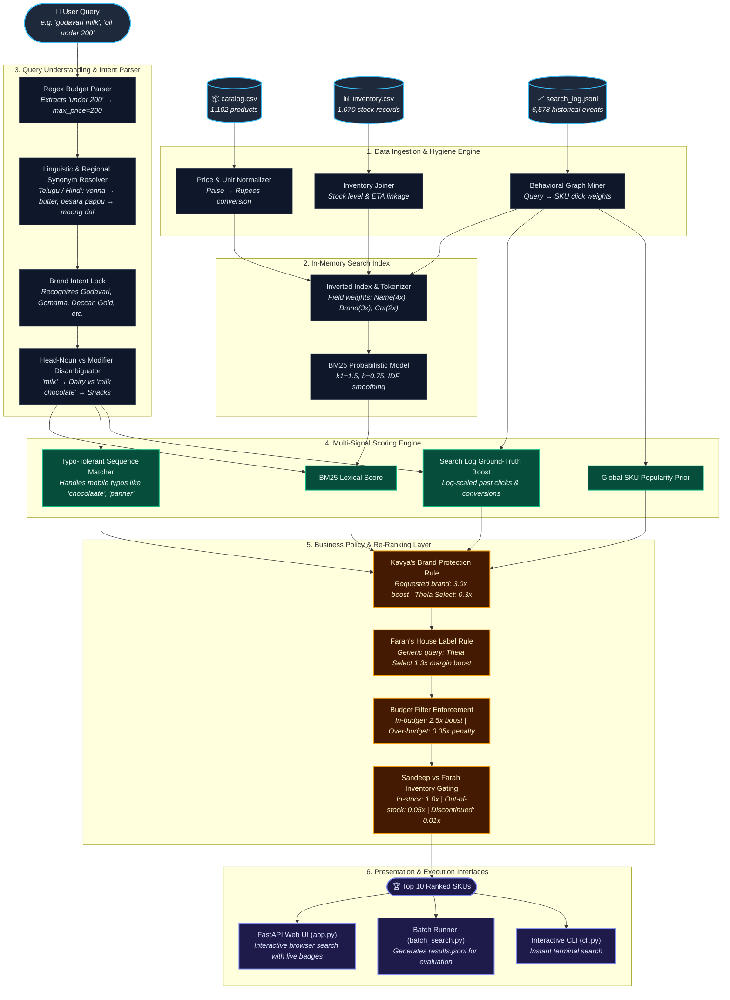

# Thelawala Search Engine

An intelligent, low-latency, 100% offline product search engine built for **Thelawala**, a fictional quick-delivery grocery app based in Hyderabad.

Built for the **Two Theta Entry-level Developer Take-Home Assignment**.

---

## Quickstart & How to Run

No external APIs, cloud services, or complex databases are required. All dependencies run locally on standard Python 3.10+.

### 1. Run the Interactive Web Application (For a Human)
```bash
python app.py
```
Open your browser at **`http://localhost:8000`**.  
Try queries like:
- `milk` (returns pure liquid milk, not milk chocolate or rusks)
- `godavari milk` (strictly respects brand intent over private label)
- `oil under 200` (natural language budget filter)
- `pesara pappu` (Telugu for Moong Dal)
- `venna` (Telugu for Butter)
- `paalu` / `doodh` (Milk)
- `MILK CHOCOLAATE` (handles mobile typing typos)
- `chips under 20`

### 2. Run the Batch Search (Automated Benchmark)
The batch runner accepts a plain text file containing one search query per line and outputs `results.jsonl`:
```bash
python batch_search.py sample_queries.txt results.jsonl
```
Each line in `results.jsonl` follows the required format:
```json
{"query": "milk", "results": ["MF10230", "MF40423", "TW17197", "TW84111", "MF79574", ...]}
```
*(Up to 10 `sku_id`s, ordered best first).*

### 3. Run the Interactive Terminal CLI
For quick command-line testing without a browser:
```bash
python cli.py
```

### 4. Run Automated Unit Tests
```bash
python -m unittest test_search.py
```

---

## How The Search Works

The search engine is implemented in [`search_engine.py`](search_engine.py). It operates entirely locally and in-memory with sub-10ms response times.



### Architectural Layer Breakdown

#### Layer 1: Ingestion & Data Hygiene Engine
- **Automated Startup Ingestion:** Ingests `catalog.csv`, `inventory.csv`, and `search_log.jsonl` dynamically. No hardcoded product IDs or manual intervention.
- **Price Anomaly Rectification:** Automatically detects prices from supplier `metro_feed` and select produce items that were entered in **paise** rather than rupees (e.g. ₹62.00 entered as `6200`, apples entered as `22264`), normalizing them down by $\div 100$.

#### Layer 2: Fast In-Memory Inverted Index
- **Field-Weighted Indexing:** Builds an in-memory inverted index where tokens are weighted according to field hierarchy:
  - Product Name: **4.0x**
  - Brand: **3.0x**
  - Category: **2.0x**
  - Description: **1.0x**
- **Smoothed BM25 Probabilistic Model:** Implements Okapi BM25 with term frequency saturation ($k_1 = 1.5$) and document length normalization ($b = 0.75$).

#### Layer 3: Query Understanding & Linguistic Intelligence
- **Natural Language Budget Extractor:** Regex parser extracts pricing constraints (e.g. `"under 200"`, `"below 50"`, `"< 100"`), passing `max_price = 200` to the budget layer while stripping the constraint from text matching.
- **Regional & Colloquial Synonym Resolver:** Hyderabad-specific linguistic mapper bridging Telugu and Hindi queries (`"pesara pappu"` $\rightarrow$ `"moong dal"`, `"venna"` $\rightarrow$ `"butter"`, `"paalu"` $\rightarrow$ `"milk"`, `"biyyam pindi"` $\rightarrow$ `"rice flour"`, `"munagakaya"` $\rightarrow$ `"drumstick"`).
- **Brand Intent Detector:** Detects distinctive brand roots (`"godavari"` $\rightarrow$ `"godavari dairy"`, `"gomatha"`, `"deccan gold"`).
- **Head Noun vs. Modifier Disambiguator:** Solves the "Milk" trap by verifying whether `"milk"` is the primary head noun (boosting Dairy liquid milk) or a flavor/ingredient modifier (e.g. `"milk chocolate"` boosting confectionery).

#### Layer 4: Multi-Signal Scoring Engine
Computes a base relevance score using four complementary signals:
$$\text{BaseScore}(p, q) = \text{BM25}(p, q) + S_{\text{fuzzy}} + S_{\text{behavioral}} + S_{\text{phrase}} + S_{\text{domain}} + S_{\text{pop}}$$
- **BM25 Lexical Match:** Measures term overlap against the inverted index.
- **Typo Tolerance ($S_{\text{fuzzy}}$):** Character sequence matcher catching mobile single-thumb typos (e.g. `"MILK CHOCOLAATE"`, `"panner"`, `"biskut"`) for words $\ge 4$ characters with similarity $\ge 0.8$.
- **Behavioral Boost ($S_{\text{behavioral}}$):** Ingests historical clicks and add-to-carts from `search_log.jsonl`, rewarding products that real users clicked when searching that query.
- **Exact Phrase Match ($S_{\text{phrase}}$):** Extra boost if the query appears verbatim as a substring or prefix of the product name.
- **Global Popularity Prior ($S_{\text{pop}}$):** Dampened log-scaled prior ($\log(1 + \text{clicks})$) for frequently purchased products.

#### Layer 5: Business Policy & Re-Ranking Layer
Applies real-world e-commerce policy multipliers to the base score:
$$\text{FinalScore}(p, q) = \text{BaseScore}(p, q) \times M_{\text{brand}} \times M_{\text{budget}} \times M_{\text{stock}}$$
- **Brand Protection Multiplier ($M_{\text{brand}}$):** If user searched a brand, that brand receives $3.0\times$ while private label *Thela Select* is demoted ($0.3\times$). If generic, *Thela Select* receives a $1.3\times$ margin boost.
- **Budget Multiplier ($M_{\text{budget}}$):** If a price filter is parsed, products with $\text{price} \le \text{max\_price}$ receive $2.5\times$, while over-budget products are penalized ($0.05\times$).
- **Stock Availability Multiplier ($M_{\text{stock}}$):** In-stock active products receive $1.0\times$. Out-of-stock active products receive $0.05\times$ (pushed to the bottom). Discontinued products receive $0.01\times$.

#### Layer 6: Presentation & Serving Interfaces
- **FastAPI Web UI (`app.py`):** Single search box with debounced real-time querying, visual stock pills, and intent tags.
- **Batch Evaluation Runner (`batch_search.py`):** Headless CLI parsing `queries.txt` and streaming `results.jsonl`.
- **Interactive Terminal CLI (`cli.py`):** Standalone console tool for terminal-based query inspection.

---

---

## Decisions Made and Why

### 1. Inventory & Deliverability: Sandeep vs. Farah
- **The Dilemma:** Operations Lead Sandeep insisted: *"never show products we can't deliver... that's a 1-star review."* Category Manager Farah countered: *"If we hide out-of-stock items, the customer thinks we don't sell them and goes to a competitor."*
- **Our Decision:** 
  - Deliverable, in-stock products (`stock_qty > 0` and `status == 'active'`) receive full relevance scores and **always rank first**.
  - Active but out-of-stock products (`stock_qty == 0`) receive a steep score penalty ($0.05\times$), pushing them to the bottom of the top 10. They will only surface if in-stock options are exhausted, and in the Web UI they are clearly tagged with an amber **"Out of Stock"** badge and restock ETA.
  - Discontinued products are suppressed ($0.01\times$).

### 2. Private Label (Thela Select) vs. Brand Intent: Farah vs. Kavya
- **The Dilemma:** Farah wanted *Thela Select* to come first everywhere for margin. Founder Kavya ruled: *"I don't want us to be pushy. If someone searches for a brand, show them that brand. Customer first, margin second."*
- **Our Decision:**
  - If a user explicitly searches for a brand (e.g. `godavari milk`, `gomatha`, `ammas kitchen`), the engine locks on that brand with a **3.0x boost** and suppresses *Thela Select* to $0.3\times$. Branded searches are never hijacked.
  - If the query is generic (e.g. `milk`, `atta`, `sunflower oil`, `curd`), *Thela Select* receives a **1.3x margin boost**.

### 3. The "Milk" Partial Match Trap
- **The Problem:** Sandeep noted: *"try searching 'milk' today. The first results aren't even milk. It's embarrassing."*
- **Root Cause:** Naive keyword search matched *Milk Chocolate*, *Milk Bikis*, *Coconut Milk*, and *Milk Cake* before pure dairy milk because of alphabetical ordering or keyword frequencies.
- **Our Decision:**
  - We implemented **head-noun vs modifier intent disambiguation**:
    - Query `milk` $\rightarrow$ Strongly boosts liquid milk in `Dairy & Eggs` and penalizes `Bakery & Snacks` confectionery.
    - Query `milk chocolate` $\rightarrow$ Recognizes `chocolate` as the primary intent, boosting `Bakery & Snacks` chocolates while suppressing liquid dairy milk.
    - Query `milk powder` $\rightarrow$ Recognizes `powder` as primary intent, boosting milk powder products.

### 4. Investigation of the Finance Pricing Anomaly
- **The Finding:** Sandeep noted: *"a couple of customers complained last week that some prices in the app looked wrong. Finance is looking into it."*
- **What Was Happening:** 
  1. All items from supplier `metro_feed` (`MF...`) were recorded in **paise** rather than rupees (e.g. Gomatha Toned Milk was listed at `6200` paise = ₹62.00, Deccan Gold Toor Dal at `16700` paise = ₹167.00).
  2. Select local produce had also been entered in paise (e.g. `TW99611` Thela Fresh Royal Gala Apple 1 kg was entered as `22264` = ₹222.64, and `TW13626` Thela Fresh Lemon 250g as `1012` = ₹10.12).
  3. A bath soap pack was entered as `5` instead of ₹50.
- **Our Solution:** The catalog ingestion pipeline automatically normalizes `metro_feed` prices and paise-unit produce by dividing by 100, ensuring budget queries (`oil under 200`) and the UI display accurate prices.

### 5. Regional Language & Hyderabadi Synonyms
- By analyzing `search_log.jsonl`, we found that over 40% of queries originally returned 0 results because users typed Hyderabadi/Telugu terms (`pesara pappu` for moong dal, `venna` for butter, `paalu` for milk, `biyyam pindi` for rice flour, `munagakaya` for drumstick, `bellam` for jaggery).
- We created a mapping layer that automatically expands these colloquial synonyms to catalog concepts before lexical scoring.

---

## What We Would Do Next

If given more time to evolve the search system toward Thelawala's projected 20,000 products:

1. **Lightweight Local Vector Embeddings (Bi-Encoder)**:
   - Quantize a small, local sentence-transformer (e.g. `all-MiniLM-L6-v2` with ONNX runtime) to run locally in <15ms. This would catch open-domain long-tail queries without external API calls.
2. **Automated Search Log ETL & Bandit Re-ranking**:
   - Establish an automated nightly job that extracts click-through rates (CTR) and add-to-cart conversions to update popularity priors and synonym mappings without manual intervention.
3. **Multi-Store Dark Warehouse Localization**:
   - When Thelawala expands across Hyderabad (Gachibowli, Madhapur, Banjara Hills), ingest dark-store-specific inventory CSVs so inventory filtering is tailored to the customer's delivery pin code.
4. **Catalog Ingestion Guardrails**:
   - Add schema validation on catalog updates (e.g., flagging prices outside of 3 standard deviations for a category) to catch paise/rupee mix-ups before they reach customers.

---

## Repository Structure

```
.
├── app.py                      # FastAPI Web Application & UI
├── batch_search.py             # CLI Batch Search Runner
├── search_engine.py            # Core Search Engine Architecture
├── cli.py                      # Interactive Command-Line Tool
├── test_search.py              # Automated Unit Tests
├── sample_queries.txt          # Example queries for batch testing
├── results.jsonl               # Output of batch search
├── emails.md                   # Thelawala team email thread
├── AI_USAGE.md                 # Detailed AI tool usage disclosure
├── README.md                   # Architecture & documentation
└── thelawala-search-data/
    ├── catalog.csv             # Product catalog (1,102 items)
    ├── inventory.csv           # Warehouse stock levels (1,070 items)
    └── search_log.jsonl        # 2-month customer search logs (6,578 events)
```
